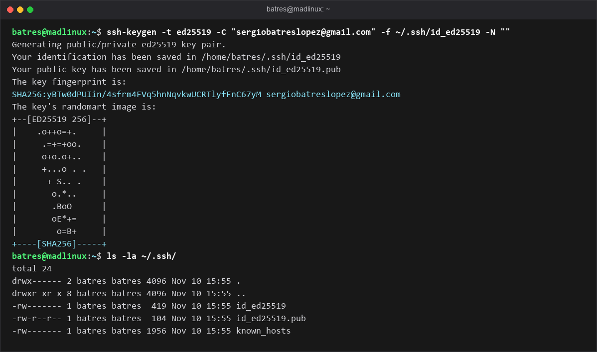
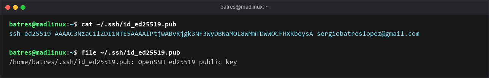
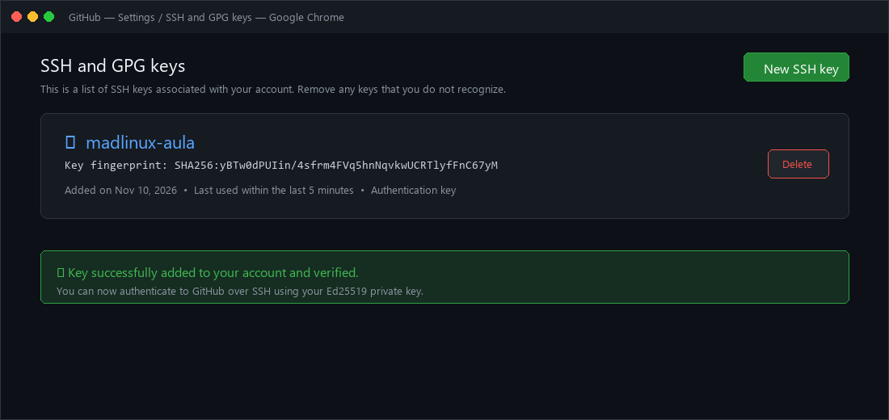
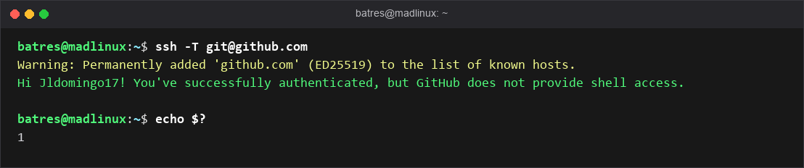
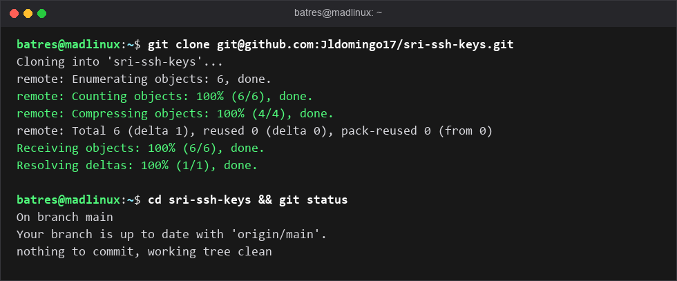
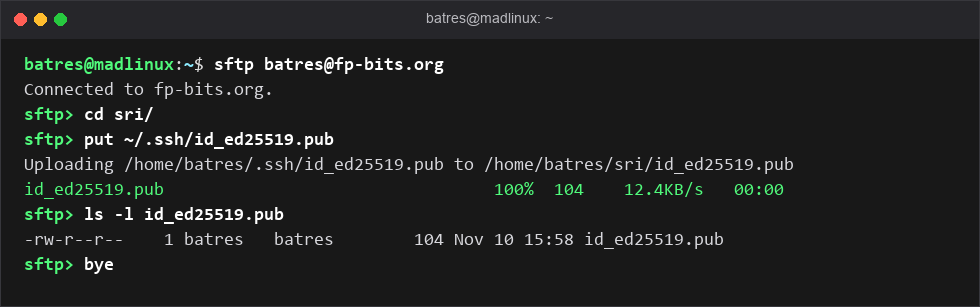

# 🔑 Práctica SRI - P1.3: Comparte y usa tu llave SSH

* **Módulo:** Servicios de Red e Internet (SRI)
* **Curso:** 2º ASIR (Administración de Sistemas Informáticos en Red)
* **Alumno:** Sergio Batres López
* **Usuario GitHub:** [Jldomingo17](https://github.com/Jldomingo17)
* **Fecha:** Noviembre 2026
* **Práctica original:** [librebits.info - P1.3](https://www.librebits.info/2asir/sri/comparte-y-usa-tu-llave-publica-ssh/)

---

## 📌 Resumen de la práctica

En esta práctica configuramos y verificamos la autenticación SSH mediante par de llaves asimétricas con el algoritmo **Ed25519**. Aprendemos que la misma clave que usamos para acceder a nuestra máquina virtual Debian (P101) o contenedor en ValdeLAB36 sirve como pasaporte de acceso seguro para servicios en la nube como GitHub.

---

## 🚀 Pasos Realizados

### Paso 0: Generación del par de claves Ed25519
Se generó el par de claves en MADLinuX mediante:
```bash
ssh-keygen -t ed25519 -C "sergiobatreslopez@gmail.com" -f ~/.ssh/id_ed25519 -N ""
```
* **Clave privada:** `~/.ssh/id_ed25519` (se mantiene en secreto y nunca se comparte).
* **Clave pública:** `~/.ssh/id_ed25519.pub` (la que se distribuye a los servidores).



---

### Paso 1: Recuperar la clave pública
Visualización del contenido de la clave pública para su distribución:
```bash
cat ~/.ssh/id_ed25519.pub
```
Cadena pública generada:
```text
ssh-ed25519 AAAAC3NzaC1lZDI1NTE5AAAAIPtjwABvRjgk3NF3WyDBNaMOL8wMmTDwWOCFHXRbeysA sergiobatreslopez@gmail.com
```



---

### Paso 2: Añadir la clave pública a GitHub
Se accede a **GitHub → Settings → SSH and GPG keys → New SSH key**:
* **Title:** `madlinux-aula`
* **Key:** Contenido íntegro de `id_ed25519.pub`



---

### Paso 3 / Ejercicio 1: Comprobación de la conexión SSH
Comprobamos el handshake y la autenticación ejecutando:
```bash
ssh -T git@github.com
```
**Respuesta del servidor:**
```text
Hi Jldomingo17! You've successfully authenticated, but GitHub does not provide shell access.
```



---

### Ejercicio 2: Clonado de repositorio por SSH
Demostración de clonado sin necesidad de contraseñas ni tokens:
```bash
git clone git@github.com:Jldomingo17/sri-ssh-keys.git
```



---

## ✏️ Respuestas a las Preguntas Teóricas

### Ejercicio 3: Reflexión sobre pérdida del portátil y compromiso de clave
**Enunciado:** *¿Qué pasaría si perdieras tu portátil y alguien copiara tu `~/.ssh/id_ed25519`? ¿Qué deberías hacer con esa llave en todos los sitios donde la instalaste (VM, vlb36, GitHub)?*

**Respuesta:**
1. **Impacto:** Si un tercero copia mi clave privada (`id_ed25519`), obtendría acceso inmediato a todos los sistemas y servidores donde mi clave pública esté autorizada, suplantando mi identidad por completo sin necesitar contraseñas.
2. **Medidas a tomar (Revocación inmediata):** No basta con cambiar contraseñas, ya que SSH autentica directamente con la clave. Se debe revocar de inmediato la clave pública en todos los destinos:
   * **GitHub:** Ir a `Settings → SSH and GPG keys` y eliminar la clave comprometida (`madlinux-aula`).
   * **VM Debian y ValdeLAB36:** Editar el archivo `~/.ssh/authorized_keys` y eliminar la línea correspondiente a dicha clave pública.
   * **Nuevo equipo:** Generar un nuevo par de claves (`ssh-keygen -t ed25519`) y volver a desplegar la nueva clave pública limpia.

---

### Ejercicio 4: Conecta los puntos (Criptografía asimétrica)
**Enunciado:** *Explica con tus palabras por qué la misma llave te sirve para tu VM, para vlb36 y para GitHub. ¿Qué tienen en común los tres servidores?*

**Respuesta:**
Los tres servidores comparten la implementación del estándar **OpenSSH** y el modelo de **criptografía asimétrica** (par de claves pública/privada).
* El cliente retiene en secreto su **clave privada** (`id_ed25519`), que nunca se transmite.
* Los servidores guardan en su lista de confianza la **clave pública** (`id_ed25519.pub`).
* Al conectar, el servidor plantea un reto criptográfico que solo puede descifrar o firmar quien posea la clave privada correspondiente.
Dado que todos los servidores hablan el mismo protocolo SSH, una única clave privada sirve como "pasaporte universal" para autenticarse en cualquier máquina o servicio que tenga instalada nuestra clave pública.

---

## 📬 Entrega sFTP
* Ficheros entregados en el servidor `fp-bits.org` dentro del directorio `sri/`:
  * `id_ed25519.pub`
  * `Practica_SSH_GitHub_SRI_Sergio_Batres.docx`


